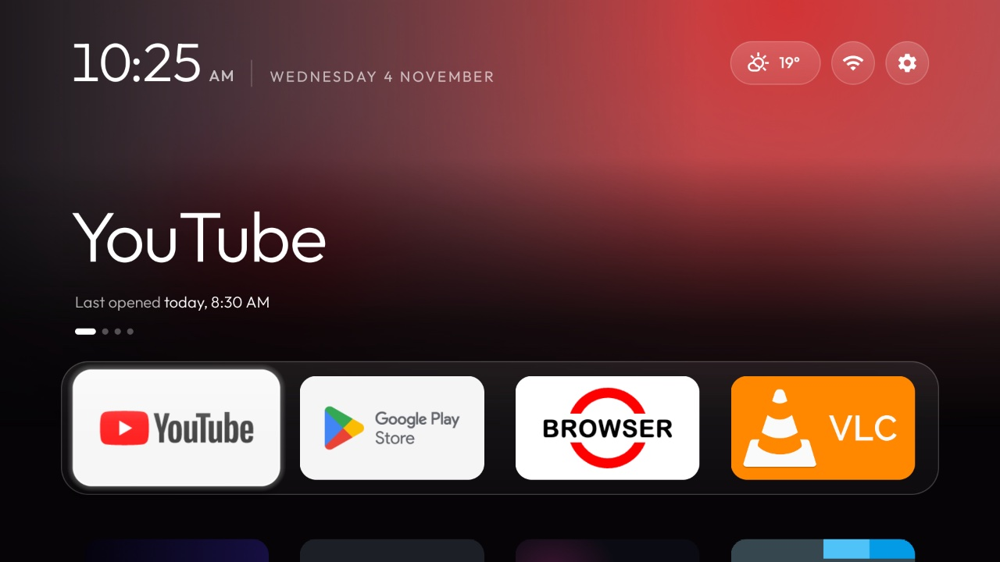
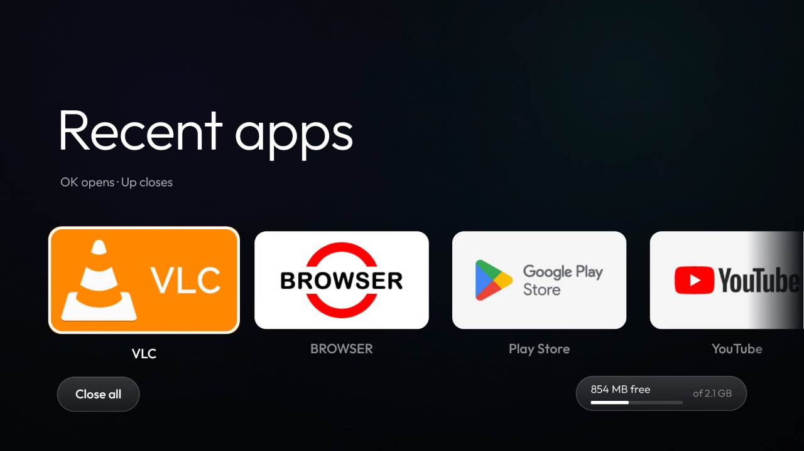
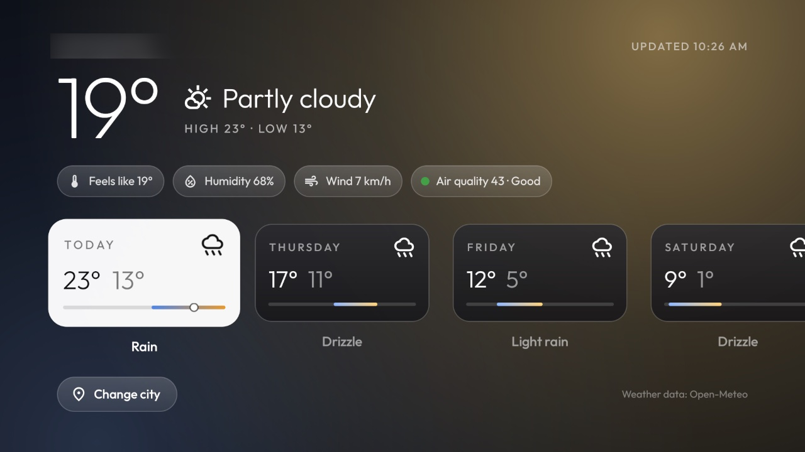
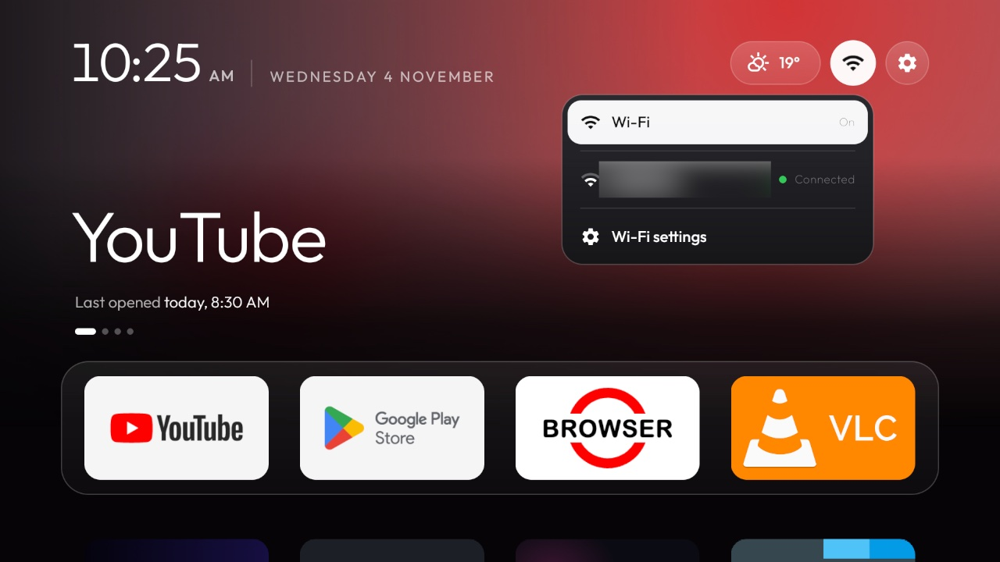
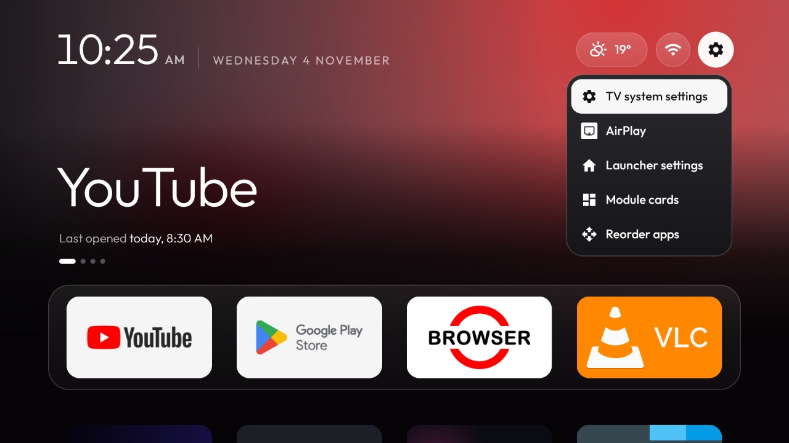
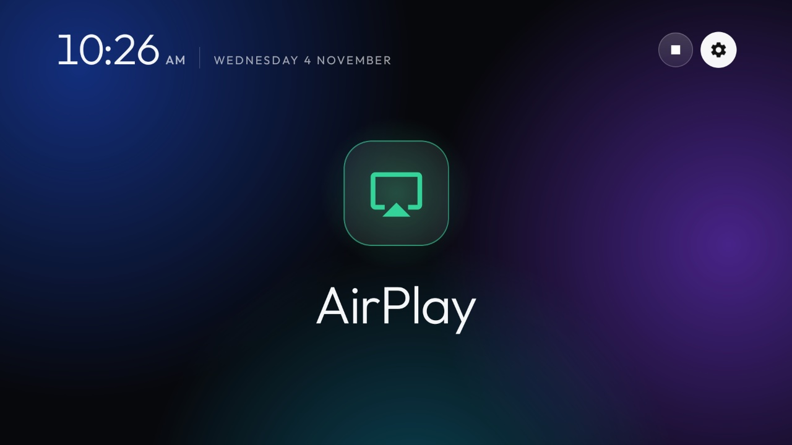

# ATV Kit

An Apple TV–style home screen for Android TV, clean and ad-free, with a weather app that matches it, a theme that
puts them together, and a TV-friendly screen-mirroring receiver. All of it is built on existing free and open-source
projects, with the changes made while setting up a Xiaomi Mi Box S (Android TV 9). Nothing here is official or
affiliated with any of the projects, companies or trademarks named below.

| Folder | What it is | Built on | Licence |
|---|---|---|---|
| [`cleanyourtv/`](cleanyourtv/) | The launcher (Home) and its tools, the Weather add-on in [`addons/weather/`](cleanyourtv/addons/weather/), and the theme in [`themes/midnight-glass/`](cleanyourtv/themes/midnight-glass/) | [CleanYourTV](https://github.com/Gathin23/cleanyourtv) | MIT, [`cleanyourtv/LICENSE`](cleanyourtv/LICENSE) |
| [`airplay/`](airplay/) | A screen-mirroring and audio receiver for Apple devices, with a TV home screen and a header matched to the launcher | [android-airplay-server](https://github.com/jqssun/android-airplay-server) | GPL-3.0, [`airplay/LICENSE`](airplay/LICENSE) |

Each folder keeps its original project's README, licence and credits; read them for how to build and install.

## Screenshots

All taken on a Xiaomi Mi Box S (Android TV 9) with the `midnight-glass` theme; the network name and the city are
blurred.

| | |
|---|---|
|  |  |
| **Recent apps**: the apps used since the TV started, closing with Up, and the memory free | **Weather**: now, its details, and today and the week on one temperature scale |
|  |  |
| **Wi-Fi menu**: the networks around, opening the TV's own page to join one | **Settings menu**: one press on the gear; AirPlay lives here instead of in the grid |
|  | |
| **Screen mirroring**: the receiver's TV screen, waiting for an iPhone, iPad or Mac | |

## What changed from the originals

**Launcher** ([`cleanyourtv/launcher/`](cleanyourtv/launcher/)). Every addition is a switch that is off by default
and documented in [`cleanyourtv/themes/README.md`](cleanyourtv/themes/README.md):

- Recent apps as a see-through panel over the running app, closing apps properly, and a free-memory pill
  (`show_memory`).
- A Wi-Fi drop-down (`wifi_menu`), a gear menu on one press (`gear_menu`, `gear_menu_apps`), and a shake while
  reordering apps (`reorder_wiggle`).
- A shaded header (`header_scrim`) and a glow that follows the focus (`glow_drift`); every animation follows the
  launcher's Animations and Advanced effects settings.
- The weather from a named app, after the date or as a top-bar button (`header_weather_app`,
  `header_weather_by_buttons`). The launcher itself stays offline: it reads the weather app's last reading on the
  TV.
- Fixes: recent apps without internet, settings opening on their first screen, alignment of the header, and a
  newly shown module card placed after the dock.

**Weather add-on** ([`cleanyourtv/addons/weather/`](cleanyourtv/addons/weather/)): the forecast from the city's
national weather service where one is available; a page redesigned in the launcher's look, with today and the week
as scrolling cards, temperature bars, a glow that follows the focused day, and the launcher's motion; and a reading
it offers Home's header.

**Theme** ([`cleanyourtv/themes/midnight-glass/`](cleanyourtv/themes/midnight-glass/)): the switches above, together.

**Screen-mirroring receiver** ([`airplay/`](airplay/)): a waiting screen for the TV with a clock and header
matched to the launcher, a mark that turns red without a network connection, and steadier clock digits.

## Tested on

A **Xiaomi Mi Box S** (MIBOX4, Android TV 9) on a 1080p TV at 60 Hz, in daily use: everything above works on it,
and it runs smoothly. Measured on the box with Android's frame statistics (`dumpsys gfxinfo`):

| What | Late frames at 60 Hz |
|---|---|
| Moving along the dock and the grid on Home | 0% |
| Home at rest | none drawn at all |
| Opening and closing the Wi-Fi and Settings menus | 0 to 1 frame |
| Scrolling the Weather page's week, with the glow following the focus | 0% |

The Mi Box S is a low-end box (2 GB of memory, a modest GPU), so other Android TV boxes and TVs should run it at
least as well; changes were measured on it before they were kept, and effects that cost frames were removed.

## Licences

This repository is a collection of separate programs, each under its own licence; nothing here changes them.

- Everything in [`cleanyourtv/`](cleanyourtv/) is under the **MIT licence** in
  [`cleanyourtv/LICENSE`](cleanyourtv/LICENSE), including the changes made here.
- Everything in [`airplay/`](airplay/) is under the **GNU GPL, version 3**, in
  [`airplay/LICENSE`](airplay/LICENSE), including the changes made here. Its linked libraries (below) keep their own
  licences; the patches it applies to UxPlay are in
  [`airplay/app/src/main/cpp/patches/`](airplay/app/src/main/cpp/patches/).
- Fonts and icons keep their own licences, listed below.

Both licences give the software **as is, without warranty of any kind**; see their texts. They allow anyone to use,
study, change and share it, under their terms: keep the copyright and licence notices, and share changes to the
GPL part under the GPL.

## Credits

**Projects this is built on**

- [CleanYourTV](https://github.com/Gathin23/cleanyourtv) by Gathin and its contributors: the launcher, tools, TV
  lists and themes (MIT).
- The Weather add-on by [Sumyabazar1](https://github.com/Sumyabazar1), part of CleanYourTV (MIT).
- [android-airplay-server](https://github.com/jqssun/android-airplay-server) by jqssun and its contributors (GPL-3.0),
  which credits [Next Player](https://github.com/anilbeesetti/nextplayer) (GPL-3.0) for its video player.
- [UxPlay](https://github.com/FDH2/UxPlay) by FDH2 and its contributors, the AirPlay protocol server (GPL-3.0).
- [FFmpeg](https://ffmpeg.org) (LGPL-2.1 or later), [libplist](https://github.com/libimobiledevice/libplist)
  (LGPL-2.1) and [openssl-cmake](https://github.com/viaduck/openssl-cmake) (MIT) with
  [OpenSSL](https://www.openssl.org) (Apache-2.0), linked from `airplay/` as Git submodules.

**Data, fonts and icons**

- Weather data by [Open-Meteo](https://open-meteo.com) (CC BY 4.0), from the models of DWD, Environment Canada,
  NOAA, Météo-France, the Met Office, MET Norway, DMI, KNMI, MeteoSwiss, JMA and CMA, and air quality from
  Copernicus (CAMS).
- [Outfit](https://github.com/Outfitio/Outfit-Fonts) by the Outfit Project Authors (SIL Open Font License 1.1, in
  each app's `FONT-LICENSE-OFL.txt`).
- [Material Symbols](https://github.com/google/material-design-icons) by Google (Apache-2.0, in
  [`LICENSES/Apache-2.0.txt`](LICENSES/Apache-2.0.txt)).
- Wallpapers and photos in the themes are credited in [`cleanyourtv/themes/README.md`](cleanyourtv/themes/README.md).

## Trademarks

AirPlay is a trademark of Apple Inc. Android, Android TV and YouTube are trademarks of Google LLC. Other names
belong to their owners. They are used here only to say what the software works with; this project is not
affiliated with or endorsed by any of them, nor by the authors of the projects it builds on.
